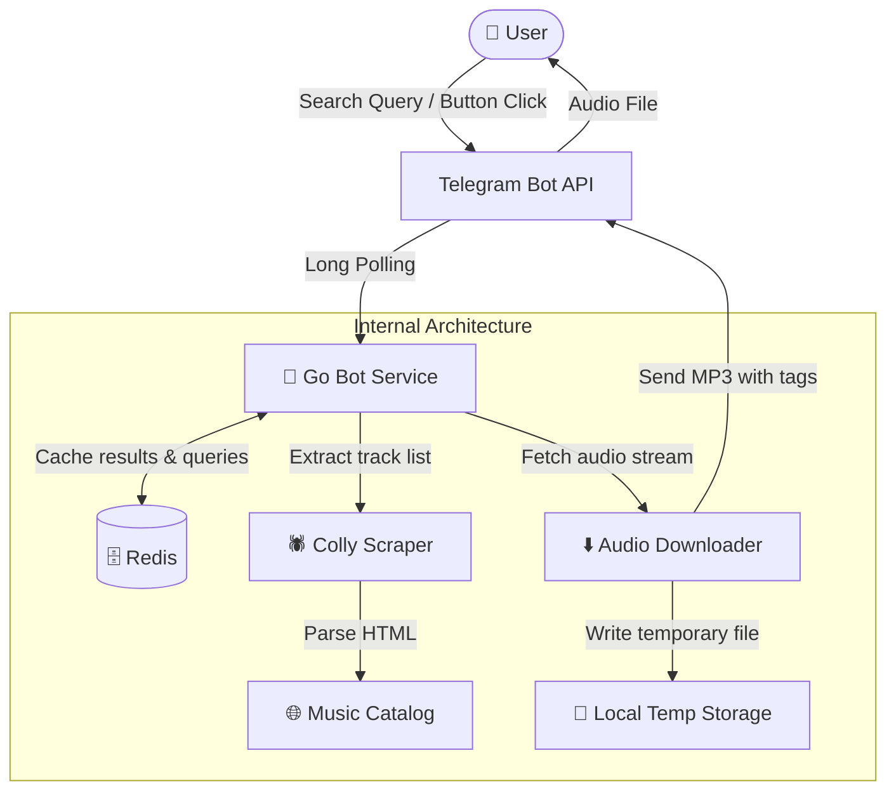

<div align="center">

# 🎵 iFinderMusic Bot

**A high-performance Go Telegram bot for searching, previewing, and downloading MP3 music tracks.**

[](https://go.dev/)
[](https://github.com/mymmrac/telego)
[](https://redis.io/)
[](https://www.docker.com/)
[](LICENSE)

<br/>

[Overview](#overview) •
[Features](#features) •
[Architecture](#architecture) •
[Quick Start](#quick-start) •
[Configuration](#configuration) •
[Project Structure](#project-structure) •
[Testing](#testing)

</div>

---

## Overview

**iFinderMusic** is a Telegram music bot that allows users to search songs by artist or title, explore trending charts and new releases, and download MP3 audio files directly into their chat.

The bot parses online music directories via a web scraper, caches search sessions in Redis to provide instant inline pagination, and asynchronously transmits audio files with proper ID3 metadata (artist, title, duration).

---

## Features

- 🔎 **Fast Music Search:** Query tracks by song name or artist (e.g., `The Weeknd`, `Miyagi`, `Queen`) with duration tags.
- 📄 **Interactive Pagination:** Paginated results (10 tracks per page) navigated via Telegram inline buttons (`⬅️ Back` / `Next ➡️`).
- 🔥 **Curated Categories:** Instant access to trending charts (`🔥 Популярные`) and newest releases (`✨ Новинки`).
- ⚡️ **Redis Caching:** Search results and user sessions are cached in Redis to minimize outbound requests and enable snappy pagination.
- 🧹 **Clean Chat UX:** Automatically removes prompt messages and temporary status indicators to keep the chat history organized.
- 🛡 **MarkdownV2 with Fallback:** Formatted text with automatic plaintext fallback in case of Telegram formatting errors.
- 🧪 **Comprehensive Test Suite:** High unit test coverage covering UI formatting, keyboard pagination, configuration, scraper mock servers, and storage.

---

## Architecture



---

## Quick Start

### Option 1: Run with Docker Compose (Recommended)

1. **Clone the repository:**
   ```bash
   git clone https://github.com/your-username/ifindermusic.git
   cd ifindermusic
   ```

2. **Configure environment variables:**
   ```bash
   cp .env.example .env
   ```
   Edit `.env` and set your `BOT_TOKEN` obtained from [@BotFather](https://t.me/BotFather).

3. **Launch the services:**
   ```bash
   docker-compose up --build -d
   ```

4. Check container logs:
   ```bash
   docker-compose logs -f bot
   ```

---

### Option 2: Run Locally

#### Prerequisites
- [Go 1.22+](https://go.dev/dl/)
- Running Redis instance (or local Docker container: `docker run -p 6379:6379 -d redis:7-alpine`)

#### Steps
1. **Copy configuration:**
   ```bash
   cp .env.example .env
   ```
   Fill in your `BOT_TOKEN`.

2. **Download dependencies:**
   ```bash
   go mod download
   ```

3. **Run the application:**
   ```bash
   go run main.go
   ```

---

## Configuration

Settings are configured via environment variables or a `.env` file:

| Variable | Required | Default | Description |
| :--- | :---: | :---: | :--- |
| `BOT_TOKEN` | **Yes** | — | Telegram Bot API token obtained from [@BotFather](https://t.me/BotFather) |
| `REDIS_ADDR` | No | `127.0.0.1:6379` | Redis connection address (`host:port`) |
| `REDIS_HOST` | No | — | Redis host (if address is not specified) |
| `REDIS_PASSWORD`| No | `""` | Redis authentication password (if enabled) |

---

## Project Structure

```
.
├── internal/
│   ├── bot/          # Telegram bot handlers, polling loop, and audio dispatcher
│   ├── config/       # Environment loading and configuration models
│   ├── model/        # Core domain models (Music track schema)
│   ├── scraper/      # Web scraper (Colly) and HTTP audio downloader
│   ├── storage/      # Redis client and cache storage operations
│   └── ui/           # Keyboards, formatting utilities, and message templates
├── .env.example      # Example environment configuration template
├── .gitignore        # Git ignore rules for binaries, env files, and temp assets
├── Dockerfile        # Production multi-stage Docker build
├── docker-compose.yml# Production stack definition (Bot + Redis)
├── go.mod            # Go module definition
├── go.sum            # Checksums for dependencies
├── LICENSE           # MIT License
└── main.go           # Application entrypoint
```

---

## Testing

Run all unit tests across the entire project:

```bash
go test -v ./...
```

Run tests with test coverage profiling:

```bash
go test -coverprofile=coverage.out ./...
go tool cover -func=coverage.out
```

---

## License

This project is licensed under the [MIT License](LICENSE).
