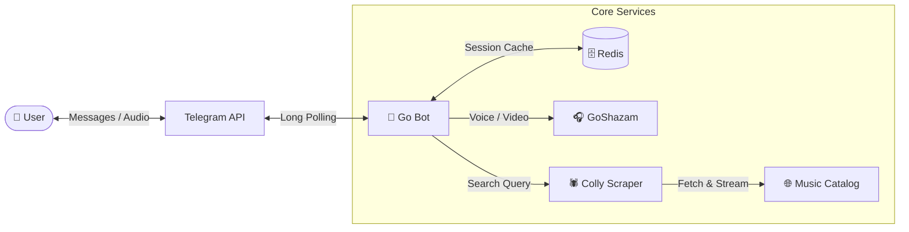

<div align="center">

# 🎵 iFinderMusic Bot

**Fast Go Telegram bot for searching, recognizing (Shazam), and downloading MP3 tracks.**

[](https://go.dev/)
[](https://github.com/mymmrac/telego)
[](https://redis.io/)
[](https://www.docker.com/)
[](LICENSE)

</div>

---

## ✨ Features

- 🔎 **Music Search** — Find tracks by artist or title with duration tags and ID3 metadata.
- 🎧 **Shazam Recognition** — Send a voice message, audio, video, or video note to identify the song and get the MP3.
- 🔥 **Charts & New Releases** — Quick access to trending tracks (`🔥 Популярные`) and fresh releases (`✨ Новинки`).
- ⚡️ **Redis Caching** — Instant inline pagination (`⬅️ Back` / `Next ➡️`) backed by Redis session caching.
- 🧹 **Clean UX** — Auto-removes temporary status messages and supports MarkdownV2 with plaintext fallback.

---

## 🏗 Architecture



---

## 🚀 Quick Start

### Docker Compose (Recommended)

```bash
git clone [https://github.com/your-username/ifindermusic.git](https://github.com/your-username/ifindermusic.git)
cd ifindermusic
cp .env.example .env
```
Set your `BOT_TOKEN` (from [@BotFather](https://t.me/BotFather)) inside `.env`, then run:

```bash
docker-compose up --build -d
```

### Local Run

Requires **Go 1.22+** and a running **Redis** instance.

```bash
cp .env.example .env
go mod download
go run main.go
```

---

## ⚙️ Configuration

| Variable | Required | Default | Description |
| :--- | :---: | :---: | :--- |
| `BOT_TOKEN` | **Yes** | — | Telegram Bot API token |
| `REDIS_ADDR` | No | `127.0.0.1:6379` | Redis address (`host:port`) |
| `REDIS_USER` | No | `default` | Redis ACL username |
| `REDIS_PASSWORD` | No | `""` | Redis password |
| `TRACK_USERS` | No | `true` | Log user activity to JSON (`true` / `false`) |
| `USERS_FILE_PATH` | No | `users.json` | File path for user activity logs |

---

## 📁 Project Structure

```text
├── internal/
│   ├── bot/          # Telegram handlers, polling loop, audio dispatcher
│   ├── config/       # Environment configuration
│   ├── model/        # Domain models
│   ├── scraper/      # Colly web scraper & MP3 downloader
│   ├── shazam/       # Audio recognition integration
│   ├── storage/      # Redis cache & user tracking
│   └── ui/           # Keyboards & message formatting
├── lib/
│   └── goshazam/     # Audio fingerprinting & Shazam library
├── Dockerfile
├── docker-compose.yml
└── main.go
```

---

## 🧪 Testing

```bash
go test -v -cover ./...
```

---

## 📄 License

Distributed under the [MIT License](LICENSE).
