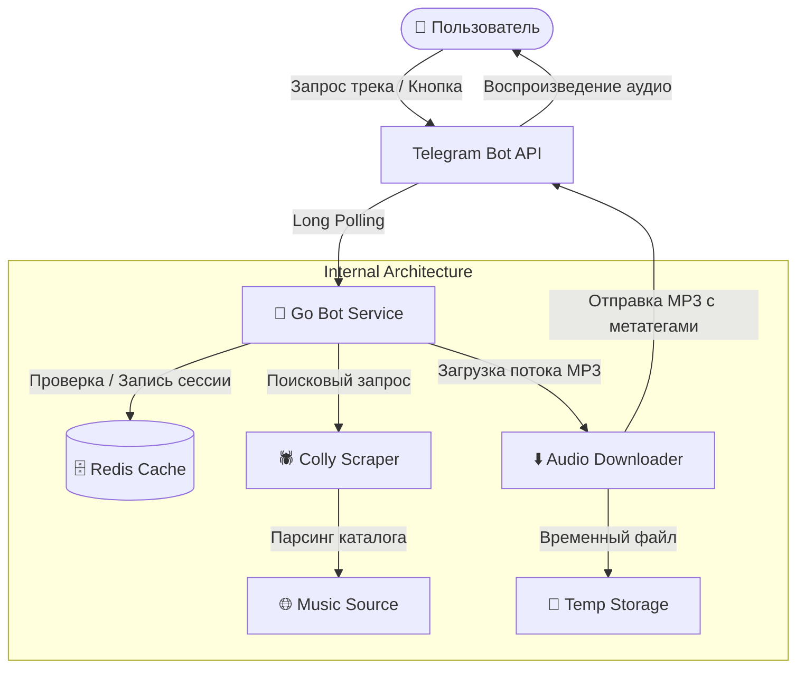

<div align="center">

# 🎵 iFinderMusic Bot

**Высокопроизводительный Telegram-бот на Go для быстрого поиска, прослушивания и скачивания музыки.**

[](https://golang.org)
[](https://github.com/mymmrac/telego)
[](https://redis.io)
[](https://www.docker.com)
[](LICENSE)

<br/>

[✨ Возможности](#-основные-возможности) •
[🏗 Архитектура](#-архитектура) •
[🚀 Быстрый старт](#-быстрый-старт) •
[⚙️ Конфигурация](#️-конфигурация) •
[📁 Структура](#-структура-проекта) •
[🤖 Использование](#-использование)

</div>

---

## 📖 О проекте

**iFinderMusic** — это современный, быстрый и удобный Telegram-бот, разработанный на языке **Go**. Бот позволяет пользователям находить любимые музыкальные композиции по названию или исполнителю, просматривать популярные треки и новинки, а также мгновенно скачивать треки в формате MP3 с тегами исполнителя и длительностью прямо в чат Telegram.

### Почему iFinderMusic?
* **Молниеносный отклик**: написан на компилируемом языке Go с минимальным потреблением ресурсов.
* **Умное кэширование**: результаты поисковой выдачи кэшируются в **Redis**, что обеспечивает моментальное переключение между страницами без повторных веб-запросов.
* **Идеальная чистота чата (Clean UX)**: бот автоматически удаляет текстовые запросы пользователя и промежуточные статусные уведомления, предотвращая загромождение диалога.
* **Отказоустойчивость**: поддержка двухрежимного форматирования текста (MarkdownV2 с прозрачным fallback на plain-text) гарантирует корректную доставку каждого сообщения.

---

## ✨ Основные возможности

- 🔎 **Быстрый поиск треков**  
  Введите имя исполнителя или название песни (например, `The Weeknd`, `Miyagi`, `Queen`) — бот мгновенно вернет список подходящих композиций с указанием длительности.

- 📑 **Интерактивная пагинация**  
  Результаты поиска группируются по 10 треков на страницу. Перелистывание страниц (`⬅️ Назад` / `Вперёд ➡️`) происходит бесшовно через Inline-кнопки без мерцания интерфейса.

- 🔥 **Быстрые категории в один клик**  
  Удобное меню внизу чата для мгновенного доступа:
  - `🔥 Популярные` — актуальные хиты и чарты;
  - `✨ Новинки` — свежие музыкальные релизы;
  - `❓ Помощь` — иллюстрированная справка по работе с ботом.

- ⚡️ **Асинхронная загрузка и отправка аудио**  
  Скачивание MP3-файла и отправка в Telegram производятся в неблокирующей горутине со статусным индикатором загрузки. Аудио отправляется с заполненными метатегами (Title, Performer, Duration).

- 🗄 **Автономный парсер на базе Colly**  
  Эффективный веб-скрапер на базе популярной Go-библиотеки [Colly](https://github.com/gocolly/colly) с поддержкой кастомных User-Agent и защитой от блокировок.

---

## 🏗 Архитектура



---

## 🚀 Быстрый старт

### Вариант 1: Запуск через Docker Compose (Рекомендуется)

Самый простой способ поднять бота вместе с изолированным Redis без необходимости вручную настраивать базы данных и зависимости:

1. **Клонируйте репозиторий:**
   ```bash
   git clone https://github.com/your-username/iFinderMusic.git
   cd iFinderMusic
   ```

2. **Создайте конфигурационный файл `.env`:**
   ```bash
   cp .env.example .env
   ```
   Откройте `.env` и укажите ваш токен бота:
   ```env
   BOT_TOKEN=1234567890:ABCdefGHIjklMNOpqrSTUvwxYZ
   ```

3. **Запустите контейнеры:**
   ```bash
   docker compose up -d
   ```

4. **Проверьте логи работы:**
   ```bash
   docker compose logs -f bot
   ```

---

### Вариант 2: Локальный запуск (Go)

#### Требования
* **Go** версии `1.22` или новее
* Запущенный сервер **Redis** (локально, через Docker или OpenServer)

#### Инструкция

1. **Клонируйте репозиторий:**
   ```bash
   git clone https://github.com/your-username/iFinderMusic.git
   cd iFinderMusic
   ```

2. **Установите зависимости:**
   ```bash
   go mod download
   ```

3. **Настройте переменные окружения:**
   Скопируйте пример файла конфигурации:
   ```bash
   cp .env.example .env
   ```
   Укажите ваш токен в файле `.env`:
   ```env
   BOT_TOKEN=your_telegram_bot_token_here
   REDIS_ADDR=127.0.0.1:6379
   REDIS_PASSWORD=
   ```

4. **Запустите проект:**
   ```bash
   go run .
   ```

---

## ⚙️ Конфигурация

Параметры считываются из системных переменных окружения или локального файла `.env`:

| Переменная | Описание | Обязательная | По умолчанию |
|---|---|:---:|---|
| `BOT_TOKEN` | Токен Telegram-бота, полученный от [@BotFather](https://t.me/BotFather) | **Да** | — |
| `REDIS_ADDR` | Сетевой адрес Redis в формате `host:port` | Нет | Автоматическое сканирование |
| `REDIS_HOST` | Хост Redis (если не указан полный адрес `REDIS_ADDR`) | Нет | — |
| `REDIS_PASSWORD`| Пароль для авторизации в Redis (AUTH) | Нет | Без пароля |

> **Примечание:** если адрес Redis не задан явно, бот автоматически проверяет доступность локальных адресов (`127.0.0.1:6379`, `redis:6379`, `host.docker.internal:6379`).

---

## 📁 Структура проекта

```text
iFinderMusic/
├── internal/
│   ├── bot/          # Логика бота, обработчики сообщений и callback-кнопок
│   ├── config/       # Загрузка и парсинг конфигурации (.env и переменные окружения)
│   ├── model/        # Модели данных (Music track entity)
│   ├── scraper/      # Веб-парсер каталога треков и загрузчик аудиофайлов
│   ├── storage/      # Взаимодействие с Redis (кэширование треков и состояний)
│   └── ui/           # Разметка Telegram (инлайн-клавиатуры, меню, MarkdownV2)
├── .env.example      # Шаблон файла конфигурации окружения
├── .gitignore        # Список исключений для Git
├── docker-compose.yml# Конфигурация для запуска в Docker Compose
├── Dockerfile        # Мульти-стейдж сборка легковесного Docker-образа
├── go.mod            # Определение Go-модуля и зависимостей
├── go.sum            # Контрольные суммы зависимостей
├── LICENSE           # Лицензия проекта (MIT)
├── main.go           # Точка входа в приложение
└── README.md         # Документация проекта
```

---

## 🤖 Использование

1. Запустите диалог с ботом командой `/start`.
2. Введите название интересующего трека или имя музыканта:
   ```text
   The Weeknd Blinding Lights
   ```
3. Бот вернет список подходящих аудиозаписей с постраничной навигацией:
   ```text
   🎵 Результаты поиска: The Weeknd Blinding Lights
   Найдено треков: 15 (страница 1 из 2)
   ```
4. Нажмите на интерактивную кнопку с нужным треком — бот скачает и отправит аудиофайл в формате MP3 прямо в чат!

---

## 🛠 Стек технологий

* **Язык**: [Go (Golang)](https://go.dev/)
* **Telegram Framework**: [Telego](https://github.com/mymmrac/telego)
* **HTML Scraping**: [Colly v2](https://github.com/gocolly/colly) & [GoQuery](https://github.com/PuerkitoBio/goquery)
* **Кэширование**: [Redis 7](https://redis.io/) & [go-redis](https://github.com/redis/go-redis)
* **Контейнеризация**: [Docker](https://www.docker.com/) & [Docker Compose](https://docs.docker.com/compose/)

---

## 📄 Лицензия

Проект распространяется под свободной лицензией **MIT**. Подробности в файле [LICENSE](LICENSE).

---

<div align="center">
  <sub>Создано с ❤️ для любителей музыки. Если проект вам понравился, поставьте ⭐️ звездочку репозиторию!</sub>
</div>
# iFinderMusic

# iFinderMusic

